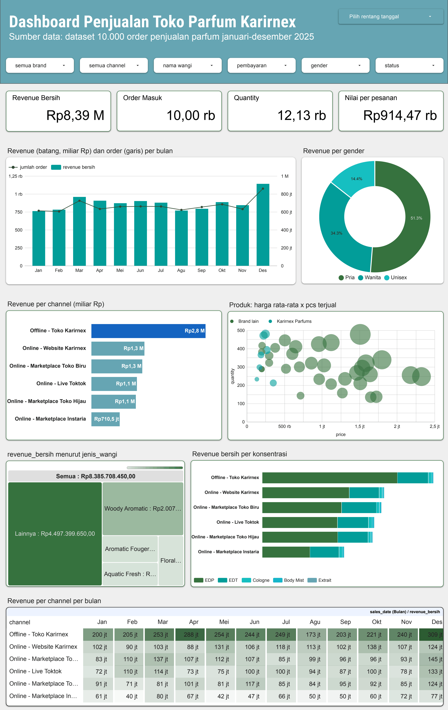
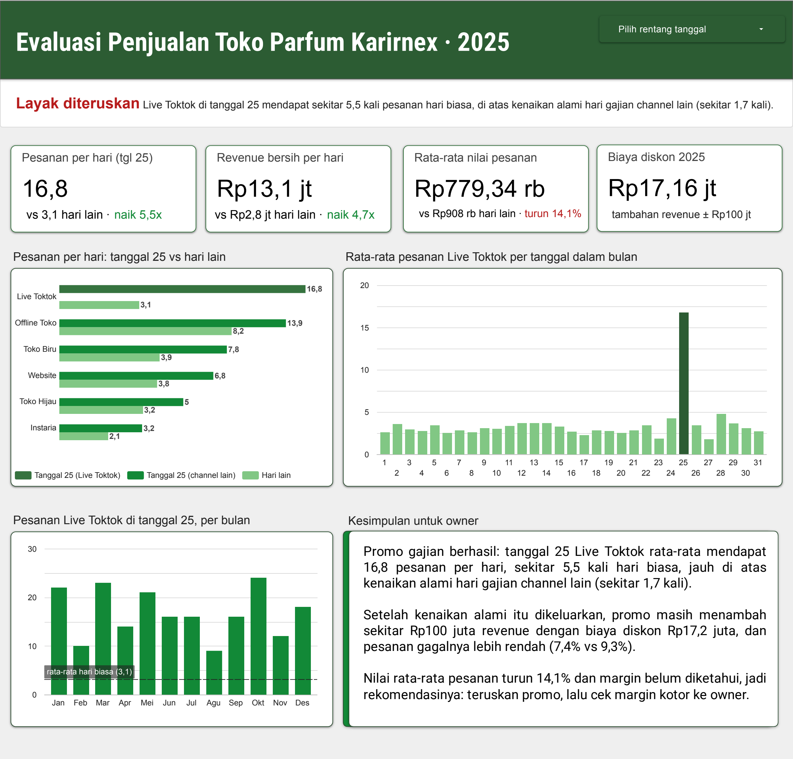
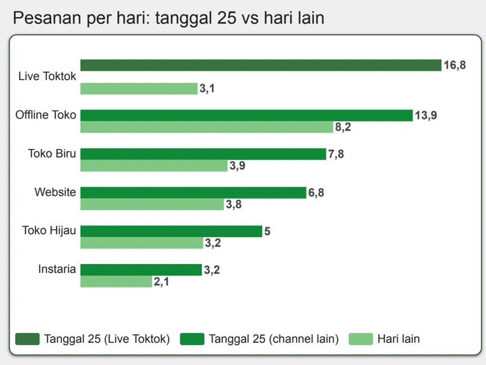
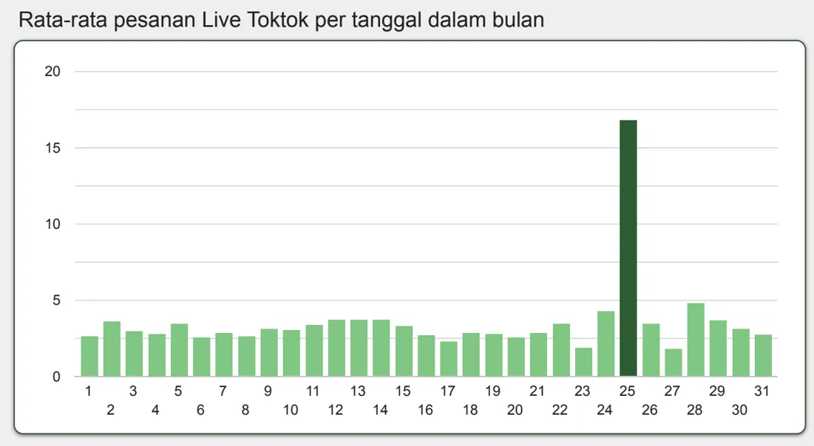
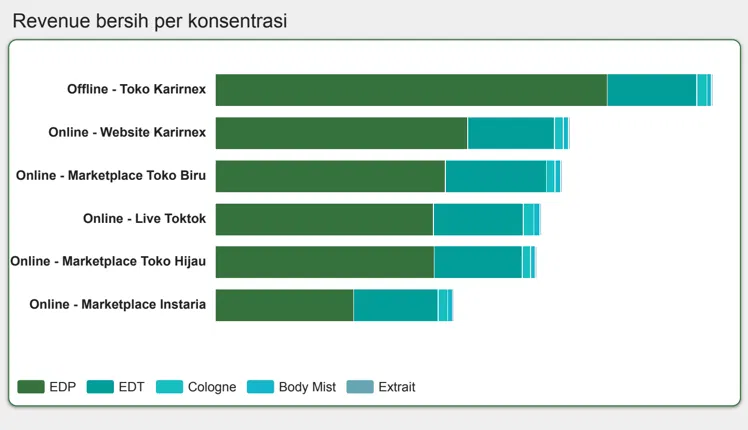
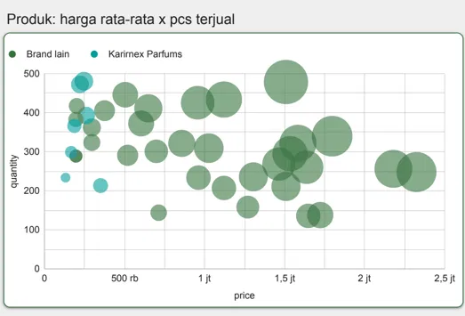

<div align="center">

# 📊 Analisis Penjualan Toko Parfum Karirnex 2025
### Mini Project Bootcamp Data Analyst Karirnex (Batch 8)


</div>

---

## 📌 Ringkasan

Proyek ini adalah mini project dari **Bootcamp Data Analyst Karirnex** (2-12 November 2026). Analisis dikerjakan dengan empat tools: **Excel**, **Google BigQuery (SQL)**, **Python (Google Colab)**, dan **Looker Studio**.

Pertanyaan utamanya: **berapa omzet bersih toko, dari channel dan produk mana asalnya, dan apakah promo tanggal 25 di Live Toktok layak diteruskan?**

**Dashboard 1: Penjualan**



**Dashboard 2: Evaluasi Promo Tanggal 25**



Dashboard interaktif: [Looker Studio](https://datastudio.google.com/reporting/12e20ef4-9d25-4099-a034-af7f4a2e588e)

> 📝 Data berupa **dataset dummy** dari bootcamp. Dataset tidak disertakan di repositori ini.

---

## 🎯 Tujuan

1. Menghitung omzet kotor (Gross), omzet bersih (Net), dan rata-rata nilai pesanan (AOV).
2. Mengukur kerugian dari order retur dan dibatalkan.
3. Menentukan gender, konsentrasi, dan channel yang paling berkontribusi.
4. Mengevaluasi promo tanggal 25 di Live Toktok.
5. Menyajikan hasilnya dalam dashboard interaktif.

---

## 📈 Hasil Utama

| Indikator | Nilai |
|---|---:|
| **Gross sales** (semua status) | **Rp9.172.438.800** |
| **Net sales** (status Selesai) | **Rp8.385.708.450** |
| **AOV** (rata-rata nilai pesanan Selesai) | **Rp914.472** |
| **Order retur + dibatalkan** | **830 order (Rp786,7 jt = 8,58% dari Gross)** |
| **Transaksi Selesai** | **91,7%** |

**1. Order retur dan dibatalkan menggerus 8,58% omzet.** Dari 10.000 order, 436 diretur dan 394 dibatalkan.

**2. Gender Pria terbesar**, yaitu 50,97% dari Net sales. Kombinasi teratas: Pria EDT (26,96%), Wanita EDP (26,69%), dan Pria EDP (24,01%). Selisih peringkat 1 dan 2 hanya 0,27 poin persentase.

**3. Offline - Toko Karirnex adalah channel terbesar**, dengan 33,85% Net sales (Rp2,84 M), lebih dari dua kali lipat channel kedua (Website Karirnex, 15,78%). Risikonya: sepertiga omzet bergantung pada satu toko fisik.

---


### Pesanan per Hari: Tanggal 25 vs Hari Lain



**1. Live Toktok naik paling tinggi pada tanggal 25.** Pesanan per hari melonjak dari 3,1 menjadi 16,8 (**5,5x**). Channel lain juga naik pada tanggal 25, tetapi hanya 1,5x sampai 2,0x (Offline 1,7x, Toko Biru 2,0x, Website 1,8x, Toko Hijau 1,6x, Instaria 1,5x). Kenaikan alami ini yang harus dikeluarkan sebelum menilai efek promo.

---

### Pola Pesanan Live Toktok per Tanggal



**2. Lonjakan hanya terjadi di tanggal 25.** Di tanggal lain, rata-rata pesanan Live Toktok berkisar 1,8 sampai 4,8 per hari, sedangkan tanggal 25 mencapai 16,8. Tidak ada tanggal lain yang mendekati, sehingga lonjakan ini bukan pola musiman bulanan.

---

### Revenue Bersih per Konsentrasi dan Channel



**3. EDP dan EDT menguasai penjualan.** EDP menyumbang 56,66% dan EDT 35,17% dari Net sales (total 91,8%), sedangkan Cologne, Body Mist, dan Extrait masing-masing di bawah 5%. Komposisinya mirip di semua channel (EDP 53% sampai 59%), jadi selera konsentrasi tidak bergantung pada channel.

---

### Harga Rata-rata vs Unit Terjual per Produk



**4. Brand sendiri, Karirnex Parfums, laku dalam jumlah tetapi murah.** Tujuh produknya berharga rata-rata sekitar Rp226 rb, jauh di bawah brand lain (sekitar Rp1,03 jt). Hasilnya, brand ini menyumbang **20,2% unit** terjual tetapi hanya **6,0% Net sales**. Brand lain bernilai tinggi tetapi unit per produk lebih sedikit.

---

## 🔍 Studi Kasus: Promo Tanggal 25 (Live Toktok)

| Metrik | Tgl 25 | Hari lain |
|---|---:|---:|
| Pesanan per hari (Live Toktok) | 16,8 | 3,1 |
| Revenue bersih per hari | Rp13,1 jt | Rp2,8 jt |
| Rata-rata nilai pesanan | Rp779 rb | Rp908 rb (turun 14,1%) |

Kenaikan alami channel lain sekitar **1,7x**, sedangkan Live Toktok naik **5,5x**. Setelah kenaikan alami dikeluarkan, promo masih menambah sekitar **Rp100 jt** revenue dengan **biaya diskon Rp17,2 jt**.

**Rekomendasi:** teruskan promo, tetapi cek margin kotor ke owner karena rata-rata nilai pesanan turun dan margin belum diketahui.

Metode lengkap ada di [`docs/studi_kasus_promo_tgl25.md`](docs/studi_kasus_promo_tgl25.md).

---

## 🗂️ Dataset

| Atribut | Keterangan |
|---|---|
| Jumlah baris | 10.000 order |
| Jumlah kolom | 19 |
| Periode | 1 Januari - 31 Desember 2025 |
| Channel | 6 (1 offline, 5 online) |
| Status | Selesai, Retur, Dibatalkan |
| Kualitas | Tanpa missing value dan tanpa duplikat |

Penjelasan tiap kolom ada di [`data/data_dictionary.md`](data/data_dictionary.md).


---

## 🧰 Teknologi dan Isi Tiap Tahap

| Tahap | Tools | Lokasi |
|---|---|---|
| Analisis awal | Microsoft Excel (PivotTable) | [`excel/`](excel/) |
| Query data | Google BigQuery (SQL) | [`sql/`](sql/) |
| Eksplorasi dan visualisasi | Python (pandas, matplotlib) di Google Colab | [`notebook/`](notebook/) |
| Dashboard | Looker Studio | [Link dashboard](GANTI_DENGAN_LINK_LOOKER_STUDIO) · [`assets/`](assets/) |

---

## 📁 Struktur Repositori

```
karirnex-perfume-sales-analysis/
├── README.md
├── .gitignore
├── assets/
│   ├── dashboard_penjualan.png
│   ├── evaluasi_promo_tgl25.png
│   ├── chart_pesanan_tgl25_vs_hari_lain.png
│   ├── chart_pesanan_per_tanggal.png
│   ├── chart_revenue_konsentrasi_channel.png
│   └── chart_scatter_harga_qty.png
├── data/
│   └── data_dictionary.md
├── excel/
│   └── langkah_pivottable.md
├── sql/
│   └── queries_bigquery.sql
├── notebook/
│   └── analisis_penjualan.ipynb
└── docs/
    └── studi_kasus_promo_tgl25.md
```

---

## 🚀 Cara Membaca

1. Mulai dari ringkasan dan analisis per chart di atas, lalu buka [`docs/studi_kasus_promo_tgl25.md`](docs/studi_kasus_promo_tgl25.md).
2. Lihat langkah Excel di [`excel/langkah_pivottable.md`](excel/langkah_pivottable.md).
3. Baca query di [`sql/queries_bigquery.sql`](sql/queries_bigquery.sql).
4. Buka notebook di [`notebook/`](notebook/) (tampil langsung di GitHub).

---

## ⚠️ Keterbatasan

- Data berupa **dataset dummy** dari bootcamp, bukan data bisnis riil.
- Tidak ada data **biaya per channel dan margin**, sehingga prioritas channel didasarkan pada omzet, bukan keuntungan.
- Tambahan revenue promo (± Rp100 jt) adalah **estimasi** terhadap baseline, bukan bukti sebab-akibat.
- Periode hanya **12 bulan (2025)**, jadi tren jangka panjang tidak dapat disimpulkan.

---

## 👤 Penulis

**Yudha Alfarizi**:  [LinkedIn](GANTI_DENGAN_LINK_LINKEDIN)

Penyelenggara bootcamp: **Karirnex**
